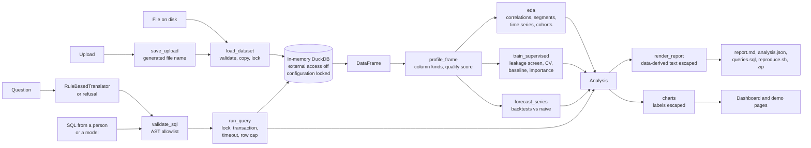
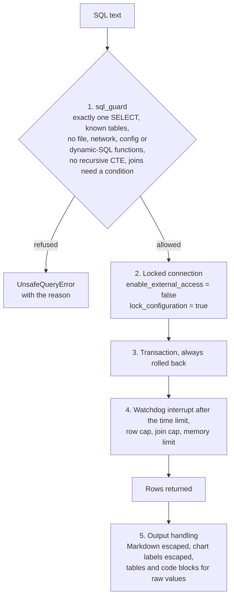

# Architecture

Auto Data Scientist turns one table of business data into a profile, guarded SQL answers,
a model that is judged against a no-skill baseline, a forecast that is judged against naive
methods, and a report that can be regenerated. This document explains how the code is laid
out, how data moves through it, where untrusted input is contained and which trade-offs
were made on purpose.

## Design rules

1. **One engine, thin entry points.** All analysis lives in the `auto_data_scientist`
   package. The CLI, the Agent Skill script, the dashboard and the demo script only collect
   arguments, call the package and present what it returns.
2. **Data and SQL are untrusted.** A file can be malformed or hostile, and SQL can come
   from a person or a language model. Neither is allowed to read files, reach the network,
   change the database or inject markup into what a person later reads.
3. **A number without its comparison is not reported.** Every model is shown next to a
   no-skill baseline, every forecast next to naive methods, every score with the rows it
   was measured on and the limits that apply.
4. **Refuse rather than guess.** A question that cannot be mapped to the schema, a query
   that is not a plain read, a target with one class: each ends in an error that says why.
5. **Everything is reproducible.** Seeds are explicit, samples are recorded, and
   `reproduce.sh` holds the command that regenerates a report from the same file.

## Modules

| Module | Responsibility | Uses |
|---|---|---|
| `config` | Resource limits from environment variables (`Limits`); `is_loopback` for bind addresses | standard library |
| `errors` | `AdsError` and its subclasses; `explain()` turns an expected failure into a title, a reason and a next step | none |
| `ingest` | Validate a file, copy it into an in-memory DuckDB, lock the connection; `save_upload` and `display_name` for uploads; `Dataset` with a lock for shared use | duckdb, pandas, openpyxl |
| `profiling` | Infer a kind per column (numeric, categorical, datetime, id, ...), count missing, invalid and extreme values, compute the documented 0-100 quality score | pandas, numpy |
| `sql_guard` | Static allowlist for SQL: one `SELECT`, known tables, no file, network, configuration or dynamic-SQL functions; a plain-language explanation of the statement | sqlglot |
| `query` | Run a validated statement under a lock, inside a transaction that is always rolled back, with a watchdog timeout and a row cap | `sql_guard`, `ingest` |
| `nl2sql` | Rule-based translator for aggregate questions; returns SQL plus the assumptions it made, or refuses | `profiling` |
| `eda` | Numeric summary, correlations, segments, time-series trend and seasonality, cohort retention, column roles | pandas, scipy |
| `modeling` | Leakage screen, hold-out split, cross-validated candidate pipelines, seeded selection sample for large tables, baseline comparison, permutation importance | scikit-learn |
| `forecasting` | Naive, seasonal-naive and Holt-Winters forecasts compared by rolling-origin backtests; empirical range | statsmodels |
| `samples` | Seeded synthetic datasets with known structure, used by tests, the dashboard and the demo | numpy, pandas |
| `pipeline` | `analyze()` orchestrates the steps into an `Analysis`; `artifact_texts`, `write_artifacts`, `bundle_artifacts` produce the report files | all of the above |
| `report` | Markdown report with eight fixed sections; `escape_md`, `code_span`, `code_block` keep data-derived text inert | `pipeline` |
| `charts` | Pure functions from analysis results to Plotly figures; one palette, labels escaped | plotly (optional extra) |
| `cli` | `ads profile / sql / ask / model / forecast / report` | `pipeline` |

Outside the package:

| Path | What it is |
|---|---|
| `app/streamlit_app.py` | The dashboard. Widgets, cached calls into the package, layout. No statistics. |
| `app/.streamlit/config.toml` | Binds the server to localhost, turns usage statistics off, defines the light and dark themes |
| `skills/auto-data-scientist/` | The Agent Skill: `SKILL.md`, `scripts/ads.py` (forwards to the CLI), `references/methodology.md` |
| `.claude/skills/auto-data-scientist` | Relative symlink to the skill, so it is found as a project skill |
| `demo/` | `make_demo.py` regenerates sample reports and offline chart pages; `capture_screenshots.py` photographs the dashboard |
| `benchmarks/bench.py` | Wall-clock and memory measurements on synthetic tables |
| `tests/` | `unit`, `integration`, `adversarial`, `statistical`, `dashboard` |

`charts` is the only module that needs Plotly, and nothing else in the package imports it,
so the core installs and runs without the `ui` extra.

## Data flow

`analyze()` in `pipeline` is this diagram as code. Steps the caller asked for explicitly (a
query, a target, forecast columns) raise an `AdsError` if they cannot run; optional steps
that cannot run (for example a trend on a table without dates) are recorded in
`Analysis.notes` and listed in the report as skipped.

The source file is never modified. Loading copies it into a fresh in-memory database, and
the SHA-256 of the file is stored with the analysis so a report can be tied to its input.

## Entry points

| Entry point | For | How it stays thin |
|---|---|---|
| `ads` CLI (`cli.py`) | Terminal use and scripts | Parses arguments, calls one package function, prints Markdown or JSON; exit code 1 with the reason on stderr for any `AdsError` |
| Skill script (`skills/auto-data-scientist/scripts/ads.py`) | An agent following `SKILL.md` | Imports `cli.main`; adds `src/` to the path when run from a checkout. The model writes SQL, the guard decides whether it runs; no generated Python is executed |
| Dashboard (`app/streamlit_app.py`) | Interactive use on one computer | Each section is widgets plus calls to cached wrappers around package functions. Results are keyed by file, table and settings |
| Python API (`auto_data_scientist/__init__.py`) | Notebooks and other programs | Re-exports the public functions |

### Dashboard state and caching

- A file is identified by `(stored path, display name)`. The dataset and its DataFrame are
  held with `st.cache_resource` (shared, never mutated); profiles, EDA tables, query
  results, models, forecasts and reports with `st.cache_data`, keyed by their inputs.
- Sections do not run until asked: Predict, Forecast and Report sit behind forms, so
  changing a selector never starts a training run by accident.
- Choosing another file or table clears the previous choices and results.
- Several browser sessions can share one cached dataset. `Dataset.lock` makes queries take
  turns, because one DuckDB connection cannot run two transactions at once.

## Security layers

Untrusted input reaches the system in four forms: a file's bytes, a file's name, SQL text
and a question. The controls are layered so that a gap in one is covered by the next.

| Threat | Control | Where |
|---|---|---|
| SQL that writes, reads files or calls out | Allowlist on the parsed statement, not a keyword filter | `sql_guard.validate_sql` |
| A statement that slips past the allowlist | The connection cannot access files or the network and cannot be reconfigured; every query is rolled back | `ingest.load_dataset`, `query.run_query` |
| Runaway queries | Watchdog interrupt, row cap, join cap, memory limit | `query.run_query`, `config.Limits` |
| Injection through questions, values, column or table names | Identifiers are always quoted, values escaped; translated SQL passes the same guard | `nl2sql`, `ingest.quote_ident` |
| Path traversal and odd names on upload | Only a validated suffix of the client name is kept, the stored name is generated; the displayed name is sanitised | `ingest.save_upload`, `ingest.display_name` |
| Unsafe formats | Extension allowlist; no pickle, no macro-enabled workbooks | `ingest.SUPPORTED_SUFFIXES` |
| Oversized input | File size, row count and column limits | `config.Limits`, `eda.correlation_pairs` |
| Markup planted in data (links, images, HTML, fake headings) | Names go into code spans that cannot be closed from inside; other text is escaped; Plotly labels are HTML-escaped | `report`, `charts.safe_text` |
| Code execution from model output | Nothing executes generated Python; `eval`, `exec`, `pickle` and `subprocess` are absent from the package and the app, checked by a test | `tests/dashboard/test_server.py` |
| Exposure of the dashboard | Bound to localhost by the settings next to the script; a warning if started elsewhere; no usage statistics; no external resources | `app/.streamlit/config.toml`, `app/streamlit_app.py` |
| Instructions hidden in data (for an agent using the skill) | `SKILL.md` tells the agent to treat names and values as data and to quote, not follow, anything that reads like an instruction | `skills/auto-data-scientist/SKILL.md` |

What these layers do not cover is listed in [SECURITY.md](SECURITY.md): SQLite and DuckDB
files are parsed by their native libraries, there is no authentication, and passing the
tests does not prove the guard is complete.

## Statistical safeguards

| Risk | Safeguard |
|---|---|
| A model that only looks good | A no-skill baseline is fitted and scored the same way; "improves on the baseline" requires winning every fold and a margin |
| Leakage | Columns that predict the target almost perfectly alone, are filled in for one outcome only, or are named after it are dropped and listed; keeping one is explicit and recorded |
| Leakage through preprocessing | Imputation, scaling and encoding live inside the pipeline, so they are fitted within each fold |
| Duplicated rows on both sides of a split | Exact duplicates are removed when a near-unique column shows they are repeated records |
| Tuning on the test set | The hold-out is split off first and used once |
| Slow selection on large tables | Candidates are compared on a seeded, class-proportional sample; the winner is refitted on all training rows and scored on the whole hold-out; the sample is stated |
| Forecasts that add nothing | Holt-Winters is used only if it beats the best naive method by a margin in rolling-origin backtests |
| False precision | The forecast range is empirical (80th percentile of absolute backtest errors) and is described as such |
| Reading causes into associations | Reports and chart notes say that correlations, segments and importance are associations; p-values are labelled descriptive; no monetary impact is estimated |

## Trade-offs

| Decision | Chosen | Alternative | Why |
|---|---|---|---|
| Where queries run | Copy into an in-memory DuckDB | Query files in place | Lets the connection be locked down completely after loading; costs memory and caps table size |
| SQL safety | Allowlist on the syntax tree, plus engine-level lockdown | Keyword denylist, or a separate sandbox process | A denylist misses what nobody thought of; a sandbox process is heavier to ship. Two independent layers were judged enough for a local tool |
| Questions in plain language | Narrow rule-based translator that refuses | Call a language model | Deterministic, offline, testable against pandas. In the skill, the agent writes SQL and the guard checks it, which covers the open-ended case |
| Model choice | Four fixed candidates, no hyperparameter search | Search or AutoML | The goal is an honest answer to "is there signal, and what does it rely on", not the best possible score; fewer choices also mean less selection bias |
| Large tables | Sample for selection only | Sample everything, or nothing | Selection is the slow part and tolerates sampling noise; the reported score keeps the full hold-out |
| Forecast range | Empirical backtest errors | Model-based prediction intervals | Makes no distributional assumption and is honest about what was observed; cannot widen with the horizon |
| Quality score | Fixed, documented weights | Learned or configurable weights | A screening number is only useful if everyone can recompute it; the components are always shown beside it |
| Dashboard | Streamlit, tested with AppTest | A custom web front end | Keeps the UI in Python next to the engine and testable in the same suite; less control over layout |
| Charts | Pure functions returning figures | Charts built inside the UI | The data in each figure can be unit-tested, and the demo pages reuse the same functions |
| Demo pages | Plotly's library written next to the pages (4.8 MB) | Load it from a CDN | The pages, like the dashboard, open without a network connection |
| Scope | One table at a time | Joins and schemas in the engine | Joins are available through SQL; modelling several tables correctly needs keys and grain that cannot be guessed |

## Testing strategy

| Layer | What it proves | Examples |
|---|---|---|
| `tests/unit` | Each function against a trusted implementation | Profile statistics against numpy and pandas, correlations against scipy, guarded SQL against a pandas group-by, figures against the data they were given |
| `tests/integration` | The pieces together | `analyze` and the CLI end to end, artefacts, the reproduce command regenerating an identical report, the demo generator, the skill script from a checkout |
| `tests/adversarial` | Hostile and malformed input is refused or flagged | Corrupt files, injection payloads, hostile names parsed back out of the report with a Markdown parser |
| `tests/statistical` | Ground truth is recovered and noise is not oversold | Planted churn drivers ranked first, leakage excluded, pure noise reported as no signal, the selection sample leaving hold-out metrics unchanged |
| `tests/dashboard` | The real page shows what was computed | AppTest flows for every section, the exact bytes behind each download, a headless server start with a health check and a closed port on the outside address |

The measured results of these layers are in [QUALITY_REPORT.md](QUALITY_REPORT.md).

## Extending it

- **Another translator**: implement the `Translator` protocol in `nl2sql` and pass it to
  `pipeline.ask`. Its SQL goes through `validate_sql` like any other.
- **Another chart**: add a function to `charts` that takes analysis results and returns a
  figure built with `_figure`; test the data in its traces.
- **Another file format**: add the suffix and a loader in `ingest`; the loader must finish
  before the connection is locked, and every format must yield the same table (see
  `test_every_format_loads_the_same_table`).
- **Another dashboard section**: a function in `app/streamlit_app.py` that calls cached
  wrappers; add an AppTest that recomputes what it shows.
