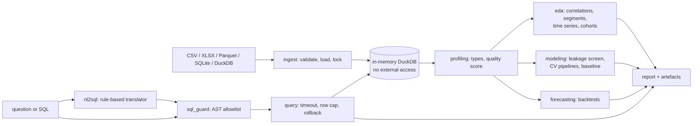

# Auto Data Scientist

Turn a raw business dataset into a reproducible analysis and an executive report, with the
statistics kept honest: a baseline next to every model, leakage screening before training,
and no significance or money claims the data cannot support.

> Status: v0.1.0, core engine + CLI + Agent Skill. The interactive dashboard is not built yet.
> See [QUALITY_REPORT.md](QUALITY_REPORT.md) for what has and has not been verified.

## What it does

| Area | Capability |
|---|---|
| Load | CSV, TSV, XLSX, Parquet, SQLite, DuckDB into a locked in-memory DuckDB. Malformed rows are rejected and counted |
| Profile | Schema and type inference, missing values, duplicates, invalid values, outliers, a documented 0-100 quality score |
| Explore | Descriptive statistics, correlations, segments, time-series trend and seasonality, cohort retention, KPI role detection |
| Ask | Read-only SQL through a four-layer guard, with a plain-language explanation; a rule-based translator for simple aggregate questions |
| Predict | Classification and regression against a no-skill baseline, cross-validated pipelines, leakage screen, permutation importance |
| Forecast | Naive, seasonal naive and Holt-Winters compared by rolling-origin backtests |
| Report | Executive summary, findings, evidence, limitations, actions; `report.md`, `analysis.json`, `queries.sql`, `reproduce.sh` |

## Install

```bash
git clone <repo-url> && cd auto-data-scientist
python -m venv .venv && source .venv/bin/activate
pip install -e ".[dev]"
```

Requires Python 3.11+.

## Use

```bash
python examples/generate_sample_data.py        # synthetic orders.csv and churn.csv

ads profile  examples/orders.csv
ads ask      examples/orders.csv "top 2 regions by total revenue"
ads sql      examples/orders.csv --query "SELECT channel, avg(revenue) FROM orders GROUP BY 1"
ads model    examples/churn.csv --target churned
ads forecast examples/orders.csv --date-col order_date --value-col revenue --horizon 6
ads report   examples/churn.csv --target churned --out report/
```

`ads ask examples/orders.csv "top 2 regions by total revenue"` prints:

````
```sql
SELECT "region", SUM("revenue") AS "sum_revenue" FROM "orders" GROUP BY "region" ORDER BY "sum_revenue" DESC LIMIT 2
```

Reads from: orders. Aggregates: SUM("revenue"). Groups by: "region". Sorted by: "sum_revenue" DESC. Returns at most 2 row(s).


| region | sum_revenue |
|---|---|
| West | 303,582 |
| East | 181,305 |
````

Anything that is not a single read-only SELECT on the loaded tables is refused:

```
$ ads sql examples/orders.csv --query "SELECT * FROM read_csv('/etc/passwd')"
error: table function read_csv() is not allowed
```

Key findings from `ads report examples/churn.csv --target churned` (synthetic data whose true
drivers are tenure, support tickets and plan):

1. The table `churn` has 3,000 rows and 7 columns; data quality score 100.0/100 (completeness 100.0%, validity 100.0%, 0 duplicate rows).
2. By `plan`, `pro` accounts for 33.8% of total `monthly_spend` (61,474 across 1,004 rows).
3. By `churned`, `0` accounts for 70.2% of total `monthly_spend` (127,728 across 2,119 rows).
4. A logistic regression model predicts `churned` with hold-out roc_auc 0.726 versus 0.500 for a no-skill baseline (600 held-out rows).

Python API:

```python
from auto_data_scientist import analyze, render_report

analysis = analyze("examples/churn.csv", target="churned", seed=0)
print(analysis.model.best_model, analysis.model.test_metrics)
print(render_report(analysis))
```

## Agent Skill

`skills/auto-data-scientist/` follows the Agent Skills layout (`SKILL.md` with `name` and
`description`, `scripts/`, `references/`). Copy or symlink the folder into `.claude/skills/`
(project) or `~/.claude/skills/` (personal). The skill script runs from a checkout without
installing the package. In the skill, the model writes SQL and the guard decides whether it
runs; the model never executes generated Python.

## Architecture



`pipeline.analyze` orchestrates these steps; `cli.py` and the skill script are thin entry
points over the same functions.

## Testing

```bash
pytest                     # 194 tests: unit, integration, adversarial, statistical
ruff check . && mypy
python benchmarks/bench.py
```

## Limits

- One table at a time; the rule-based translator handles aggregate questions only.
- No hyperparameter search, calibration or class-imbalance handling; no causal inference.
- No dashboard yet, and no charts.

Method details: [skills/auto-data-scientist/references/methodology.md](skills/auto-data-scientist/references/methodology.md).
Security model: [SECURITY.md](SECURITY.md). All sample data is synthetic.

## License

MIT
