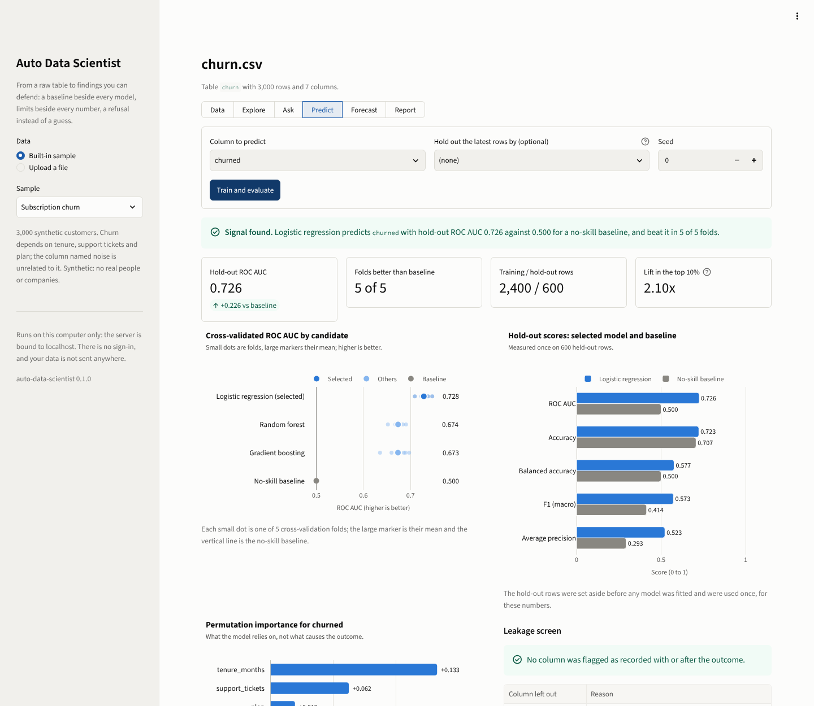
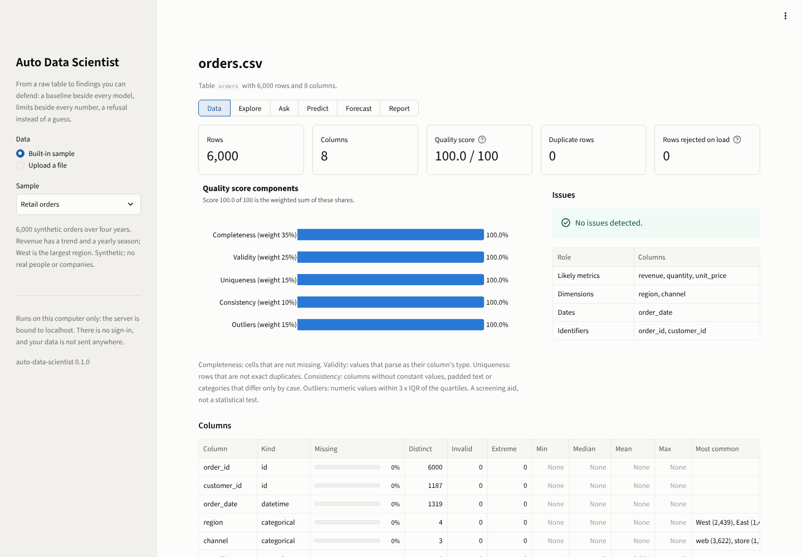
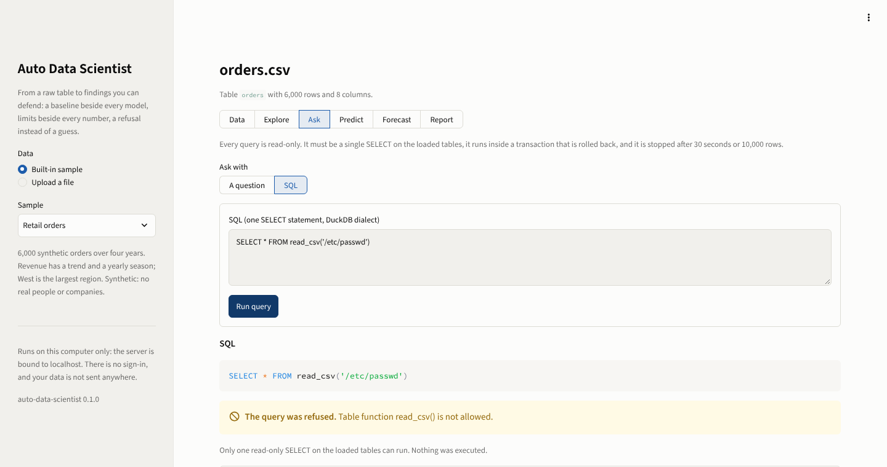
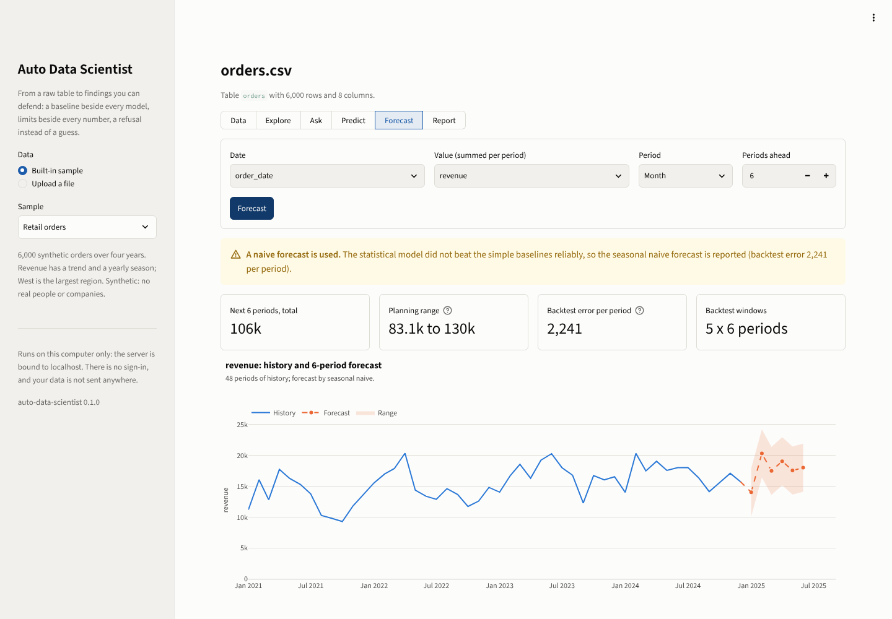
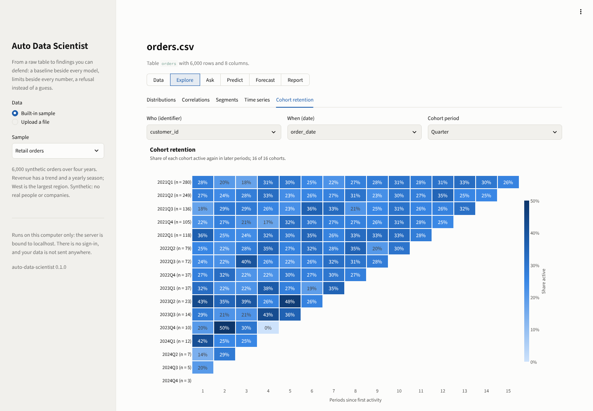
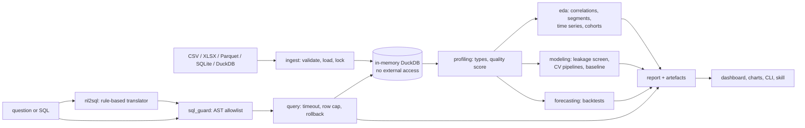

# Auto Data Scientist

Turn a raw business dataset into a reproducible analysis and an executive report, with the
statistics kept honest: a baseline next to every model, leakage screening before training,
and no significance or money claims the data cannot support.

> Status: v0.1.0, not released. Engine, CLI, Agent Skill and dashboard are built and tested;
> an independent review is still open. See [QUALITY_REPORT.md](QUALITY_REPORT.md) for what
> has and has not been verified.



## What it does

| Area | Capability |
|---|---|
| Load | CSV, TSV, XLSX, Parquet, SQLite, DuckDB into a locked in-memory DuckDB. Malformed rows are rejected and counted |
| Profile | Schema and type inference, missing values, duplicates, invalid values, outliers, a documented 0-100 quality score |
| Explore | Descriptive statistics, correlations, segments, time-series trend and seasonality, cohort retention, KPI role detection |
| Ask | Read-only SQL through a four-layer guard, with a plain-language explanation; a rule-based translator for simple aggregate questions that refuses rather than guesses |
| Predict | Classification and regression against a no-skill baseline, cross-validated pipelines, leakage screen, permutation importance; a seeded selection sample for large tables |
| Forecast | Naive, seasonal naive and Holt-Winters compared by rolling-origin backtests |
| Report | Executive summary, findings, evidence, limitations, actions; `report.md`, `analysis.json`, `queries.sql`, `reproduce.sh` |
| Dashboard | A local Streamlit app over the same engine, with Plotly charts and downloads |

## Install

```bash
git clone <repo-url> && cd auto-data-scientist
python -m venv .venv && source .venv/bin/activate
pip install -e ".[dev,ui]"      # ".[ui]" is enough to run the dashboard; the CLI needs no extra
```

Requires Python 3.11+.

## Use

```bash
python examples/generate_sample_data.py        # synthetic orders.csv and churn.csv

ads profile  examples/orders.csv
ads ask      examples/orders.csv "top 2 regions by total revenue"
ads sql      examples/orders.csv --query "SELECT channel, avg(revenue) FROM orders GROUP BY 1"
ads model    examples/churn.csv --target churned
ads forecast examples/orders.csv --date-col order_date --value-col revenue --horizon 6
ads report   examples/churn.csv --target churned --out report/
```

`ads ask examples/orders.csv "top 2 regions by total revenue"` prints:

````
```sql
SELECT "region", SUM("revenue") AS "sum_revenue" FROM "orders" GROUP BY "region" ORDER BY "sum_revenue" DESC LIMIT 2
```

Reads from: orders. Aggregates: SUM("revenue"). Groups by: "region". Sorted by: "sum_revenue" DESC. Returns at most 2 row(s).


| region | sum_revenue |
|---|---|
| West | 303,582 |
| East | 181,305 |
````

Anything that is not a single read-only SELECT on the loaded tables is refused:

```
$ ads sql examples/orders.csv --query "SELECT * FROM read_csv('/etc/passwd')"
error: table function read_csv() is not allowed
```

Key findings from `ads report examples/churn.csv --target churned` (synthetic data whose true
drivers are tenure, support tickets and plan):

1. The table `churn` has 3,000 rows and 7 columns; data quality score 100.0/100 (completeness 100.0%, validity 100.0%, 0 duplicate rows).
2. By `plan`, `pro` accounts for 33.8% of total `monthly_spend` (61,474 across 1,004 rows).
3. By `churned`, `0` accounts for 70.2% of total `monthly_spend` (127,728 across 2,119 rows).
4. A logistic regression model predicts `churned` with hold-out roc_auc 0.726 versus 0.500 for a no-skill baseline (600 held-out rows).

Python API:

```python
from auto_data_scientist import analyze, render_report

analysis = analyze("examples/churn.csv", target="churned", seed=0)
print(analysis.model.best_model, analysis.model.test_metrics)
print(render_report(analysis))
```

## Dashboard

```bash
pip install -e ".[ui]"
streamlit run app/streamlit_app.py      # opens http://localhost:8501
```

It works without a file and without a network connection: two built-in synthetic samples
(retail orders, subscription churn) are a click away, and nothing is loaded from other
hosts. Upload a CSV, TSV, XLSX, Parquet, SQLite or DuckDB file to use your own data.

| Section | What you get |
|---|---|
| Data | Rows, columns, the quality score and its five components, issues, column roles, a preview |
| Explore | Distributions, correlations, segments, a time series with its trend, cohort retention |
| Ask | A SQL box and a question box. The SQL, what it does, the result and any refusal with its reason are always shown |
| Predict | Pick a target: candidates against the no-skill baseline, hold-out scores, leakage findings, permutation importance |
| Forecast | Pick a date and a value: the method that survived the backtests, a planning range, backtest errors |
| Report | The rendered report, and `report.md`, `analysis.json`, `queries.sql` and `reproduce.sh` as one zip or one by one |

| | |
|---|---|
|  |  |
|  |  |

**The dashboard has no sign-in.** `app/.streamlit/config.toml` binds it to localhost, the
sidebar warns if it is started on any other address, and uploads are kept in a temporary
folder that is removed when the server stops. Do not expose it to a network as it is; see
[SECURITY.md](SECURITY.md).

The dashboard is a thin layer: every number and chart comes from the package
(`auto_data_scientist.charts` holds the Plotly figures as pure functions), results are
cached per file, table and setting, and no generated Python is ever executed.

## Demo

Everything under [`demo/`](demo) is generated from the synthetic samples:

| Path | What it is |
|---|---|
| [`demo/orders/report.md`](demo/orders/report.md) | A report with a translated question and a six-month forecast |
| [`demo/churn/report.md`](demo/churn/report.md) | A report with a SQL query and a churn model against its baseline |
| `demo/orders/`, `demo/churn/` | The other artefacts of each report: `analysis.json`, `queries.sql`, `reproduce.sh` |
| `demo/charts/index.html` | Every chart on one page; `demo/charts/*.html` holds one page per chart. Download the folder and open a page in a browser: Plotly's library sits next to the pages, so they work offline |
| `demo/screenshots/` | The dashboard screenshots used above |

```bash
python demo/make_demo.py               # reports and chart pages
python demo/capture_screenshots.py     # screenshots; needs ".[demo]" and Chrome or Chromium
```

## Agent Skill

`skills/auto-data-scientist/` follows the Agent Skills layout (`SKILL.md` with `name` and
`description`, `scripts/`, `references/`). In a clone of this repository it is already a
project skill: `.claude/skills/auto-data-scientist` is a relative symlink to it. For
personal use, copy or symlink the folder into `~/.claude/skills/`. The skill script runs
from a checkout without installing the package. In the skill, the model writes SQL and the
guard decides whether it runs; the model never executes generated Python, and it is told to
treat names and values in the data as data, not as instructions.

## Architecture



`pipeline.analyze` orchestrates these steps; `cli.py`, the skill script and the dashboard
are thin entry points over the same functions. Module responsibilities, the security layers
and the trade-offs are in [ARCHITECTURE.md](ARCHITECTURE.md).

## Testing

```bash
pytest                     # 322 tests: unit, integration, adversarial, statistical, dashboard
ruff check . && mypy
python benchmarks/bench.py
```

The dashboard tests drive the real script with Streamlit's `AppTest` and start it once as a
headless server. Measured results, including coverage and benchmarks, are in
[QUALITY_REPORT.md](QUALITY_REPORT.md).

## Limits

- One table at a time; the rule-based translator handles aggregate questions only.
- No hyperparameter search, calibration or class-imbalance handling; no causal inference.
- The dashboard is a single-user local tool: no sign-in, no saved sessions.
- On tables with more than 20,000 training rows, candidate models are compared on a seeded
  sample (the report says so); the reported score still comes from the whole hold-out.

Method details: [skills/auto-data-scientist/references/methodology.md](skills/auto-data-scientist/references/methodology.md).
Security model: [SECURITY.md](SECURITY.md). Contributing: [CONTRIBUTING.md](CONTRIBUTING.md).
Portfolio notes: [PORTFOLIO.md](PORTFOLIO.md). All sample data is synthetic.

## License

MIT
